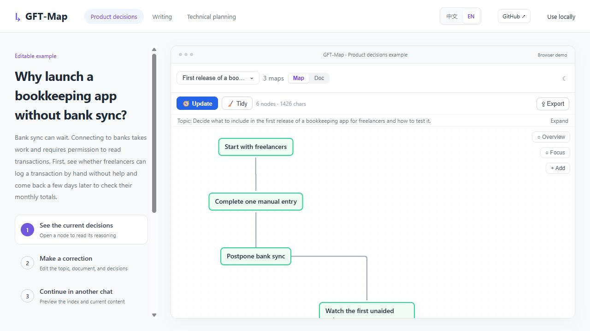

<p align="center"><strong>English</strong> · <a href="README_ZH.md">简体中文</a></p>

<h1>
  <picture>
    <source media="(prefers-color-scheme: dark)" srcset="https://raw.githubusercontent.com/CoralLips/gft-map/main/apps/gft-local/showcase/assets/wordmark-dark.svg">
    
  </picture>
</h1>

Come back to a project a few days later and you may have to reread an old chat to remember what you decided, why, and what comes next. GFT-Map organizes AI discussions about one topic into a mind map and a written explanation. You can correct a decision, then ask an agent in a fresh chat to read the updated document and pick up where you left off.

### [Why postpone bank sync in the first release?](https://corallips.github.io/gft-map/demo.html?lang=en&case=product)

In this fictional bookkeeping project, bank sync takes engineering time and requires access to people's transactions. The team wants to see whether freelancers can log one transaction by hand and come back a few days later to check their totals.

[](https://corallips.github.io/gft-map/demo.html?lang=en&case=product)

Open **Postpone bank sync** to read the reasoning. You can edit a decision and preview what a new chat could read. The demo uses prewritten material and runs in your browser without installation or model calls.

More examples · [Why cut the claim that all meetings are a waste?](https://corallips.github.io/gft-map/demo.html?lang=en&case=writing&view=doc) · [Which parts of an interrupted upload need to be sent again?](https://corallips.github.io/gft-map/demo.html?lang=en&case=engineering)

<a id="第一次使用"></a>
<a id="开始使用"></a>

## Get started

You'll need **Node.js 22.20+** and the Codex or Claude Code CLI installed and signed in. Run the command for your agent.

**Codex**

```sh
npx skills add CoralLips/gft-map --skill gft-map --agent codex --global
```

**Claude Code**

```sh
npx skills add CoralLips/gft-map --skill gft-map --agent claude-code --global
```

Reopen your chat and ask it to “Open gft-map.” The first launch needs internet access to prepare the connection. Open the local panel at the address the agent returns, usually `http://127.0.0.1:4317/`. [Installation and sign-in guide (Chinese)](https://github.com/CoralLips/gft-map/blob/main/apps/gft-local/ADVANCED.md#installation)

<a id="日常使用"></a>
<a id="everyday-use"></a>

### Use it with your own discussions

1. Create a map in the panel, click **Update**, and select a chat. Choose **Include existing content** to bring in earlier messages. Future updates pick up new messages. You can also **Import** a text or Markdown file.
2. Open **Map** to see how the decisions relate. Click one to edit its title or explanation. Use **Doc** to read or edit the longer account. To combine repeated ideas, select the relevant decisions and click **Tidy**.
3. In another chat, name the map and the task. If you called yours “Bookkeeping v1,” for example, ask “Use gft-map to connect to and read ‘Bookkeeping v1.’ Help me plan a test of manual entry with a freelancer.” The agent checks an index of connected maps and reads the current content as needed. Edits in the panel are available the next time it reads.

To share your work, copy the Doc or download the complete map and import it on another computer. [Editing and export guide (Chinese)](https://github.com/CoralLips/gft-map/blob/main/apps/gft-local/ADVANCED.md#editing)

### Data and AI usage

Maps stay on your computer by default. You can use the local app without a GFT account. In **Settings → AI processing**, choose Codex or Claude Code. **Update** and **Tidy** send the material each task needs to that agent's model service and use its account quota. GFT-Map only imports chats and materials you select.

If you sign in to a GFT account, your maps, including existing ones, sync to GFT's cloud. Deleting a synced map also deletes it on the other side. Local changes are kept and retried if the network fails. [Account and sync details (Chinese)](https://github.com/CoralLips/gft-map/blob/main/apps/gft-local/ADVANCED.md#account)

<a id="open-close-and-update"></a>
<a id="update-your-installation"></a>

### Update the app

Pause file processing and finish or cancel other running tasks, then ask your agent to update.

> Use gft-map to update to the latest stable release. Keep my maps, chat connections, and settings. Restart the panel and verify that the running version matches the installed version.

Closing the page leaves the local service running. Ask your agent to open or close GFT-Map. [Update and recovery (Chinese)](https://github.com/CoralLips/gft-map/blob/main/apps/gft-local/ADVANCED.md#upgrade) · [Running the app and troubleshooting (Chinese)](https://github.com/CoralLips/gft-map/blob/main/apps/gft-local/ADVANCED.md#打开本地页面)

## Project status and feedback

The current stable release is [v0.3.19](https://github.com/CoralLips/gft-map/releases/latest). Work now focuses on fixes and maintenance. We'd like to hear which task you continued and what you still had to explain again. Remove private conversations and credentials before posting. [Share feedback](https://github.com/CoralLips/gft-map/issues)

[Detailed guide (Chinese)](https://github.com/CoralLips/gft-map/blob/main/apps/gft-local/ADVANCED.md) · [Contributing (Chinese)](https://github.com/CoralLips/gft-map/blob/main/apps/gft-local/CONTRIBUTING.md) · [MIT License](https://github.com/CoralLips/gft-map/blob/main/LICENSE)
