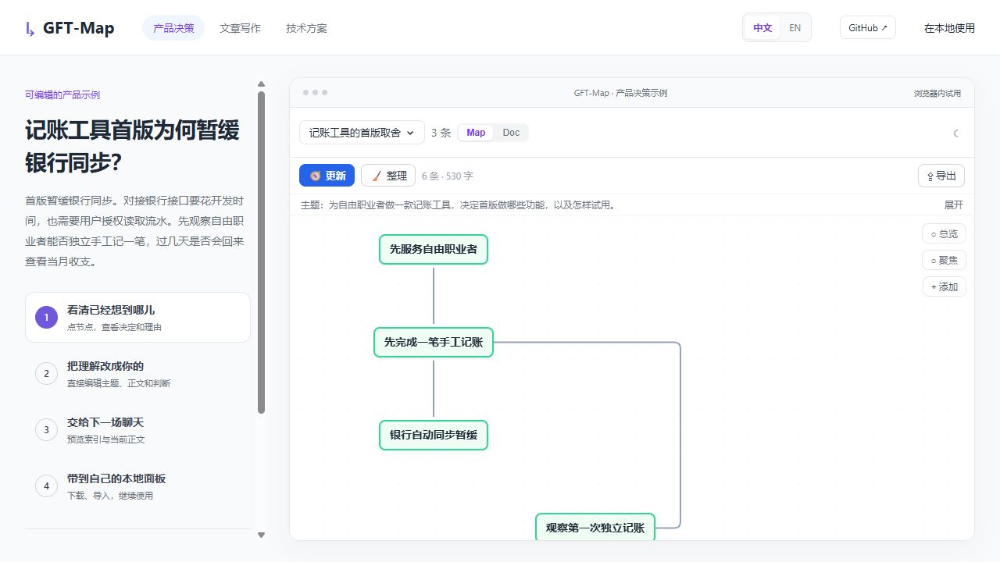

<p align="center"><a href="README.md">English</a> · <strong>简体中文</strong></p>

# GFT-Map

隔几天回到一个项目，往往得翻聊天记录，才知道上次定了什么、为什么这么定、下一步要做什么。GFT-Map 把同一主题下的 AI 讨论整理成一张导图和一份说明。你可以纠正其中的判断，再让下一场聊天读取这份脉络，接着做。

### [为什么首版暂缓银行同步？](https://corallips.github.io/gft-map/demo.html?lang=zh&case=product)

在这个虚构的记账项目里，接银行接口要花开发时间，也要用户授权读取流水。团队想先看看自由职业者能否自己记完一笔，过几天还愿不愿意回来查账。

[](https://corallips.github.io/gft-map/demo.html?lang=zh&case=product)

打开示例，点「银行自动同步暂缓」看理由。你可以改一条判断，再预览下一场聊天能读到什么。示例用的是预置材料，无需安装，也不调用模型。

其他示例 · [写文章时，为什么删去“会议都是浪费”？](https://corallips.github.io/gft-map/demo.html?lang=zh&case=writing&view=doc) · [上传中断后，哪些分片需要重传？](https://corallips.github.io/gft-map/demo.html?lang=zh&case=engineering)

<a id="第一次使用"></a>

## 开始使用

准备 **Node.js 22.20+**，安装并登录你使用的 Codex 或 Claude Code 命令行工具，然后运行对应的安装命令。

**Codex**

```sh
npx skills add CoralLips/gft-map --skill gft-map --agent codex --global
```

**Claude Code**

```sh
npx skills add CoralLips/gft-map --skill gft-map --agent claude-code --global
```

安装后重新打开聊天，说「打开 gft-map」。首次使用需要联网准备连接组件。按 Agent 返回的地址打开本地面板，通常是 `http://127.0.0.1:4317/`。[安装与授权说明](https://github.com/CoralLips/gft-map/blob/main/apps/gft-local/ADVANCED.md#installation)

<a id="日常使用"></a>

### 整理自己的讨论

1. 在面板新建脉络，点 **更新**，选择要收录的聊天。要从之前聊过的内容开始，就选 **包含已有内容**。以后点 **更新** 会接着收录新增消息。手头已有文本或 Markdown 文件，也可以点 **导入**。
2. 在 **Map** 看判断之间的关系，点一个判断可以改标题和说明。在 **Doc** 读写完整的文字说明。要收拢重复内容，可以选中相关判断再点 **整理**。
3. 在另一场聊天里说出脉络名称和下一项任务。例如，如果你的脉络叫「记账工具首版」，可以说「使用 gft-map，连接并读取『记账工具首版』，帮我准备一次手工记账的用户试用」。Agent 会先看已连接主题的简短索引，再按任务读取当前内容。面板里的修改在下次读取时生效。

想把结果交给别人，可以复制 Doc，也可以下载完整脉络，在另一台电脑导入。[编辑与导出说明](https://github.com/CoralLips/gft-map/blob/main/apps/gft-local/ADVANCED.md#editing)

### 数据和 AI 额度

脉络保存在本机，本地使用无需 GFT 账号。在 **设置 → AI 处理** 选择 Codex 或 Claude Code。点击 **更新** 或 **整理** 时，任务所需材料会发送给所选 Agent 的模型服务，占用该账号的额度。GFT-Map 只收录你选择的聊天和材料。

如果登录 GFT 账号，已有脉络也会自动同步到 GFT 云端。已同步脉络的删除会传到另一端，网络失败时保留本机修改并重试。[账号与同步说明](https://github.com/CoralLips/gft-map/blob/main/apps/gft-local/ADVANCED.md#account)

<a id="打开关闭与更新"></a>
<a id="更新到新版"></a>

### 更新安装

先暂停文件整理，完成或取消其他正在运行的任务，然后让 Agent 执行更新。

> 使用 gft-map，更新到最新正式版，保留我的脉络、聊天连接和设置。重启面板，确认运行的版本和安装的版本一致。

关闭网页后本地服务仍会运行，可以让 Agent 打开或关闭 GFT-Map。[更新与恢复](https://github.com/CoralLips/gft-map/blob/main/apps/gft-local/ADVANCED.md#upgrade) · [运行与排障](https://github.com/CoralLips/gft-map/blob/main/apps/gft-local/ADVANCED.md#打开本地页面)

## 项目状态与反馈

当前正式版为 [v0.3.18](https://github.com/CoralLips/gft-map/releases/latest)，后续以修复和维护为主。欢迎分享你实际接续的任务，以及哪里仍需要重新解释。反馈问题时请去掉私人聊天和凭证。[提交反馈](https://github.com/CoralLips/gft-map/issues)

[详细使用指南](https://github.com/CoralLips/gft-map/blob/main/apps/gft-local/ADVANCED.md) · [开发与贡献](https://github.com/CoralLips/gft-map/blob/main/apps/gft-local/CONTRIBUTING.md) · [MIT 许可证](https://github.com/CoralLips/gft-map/blob/main/LICENSE)
